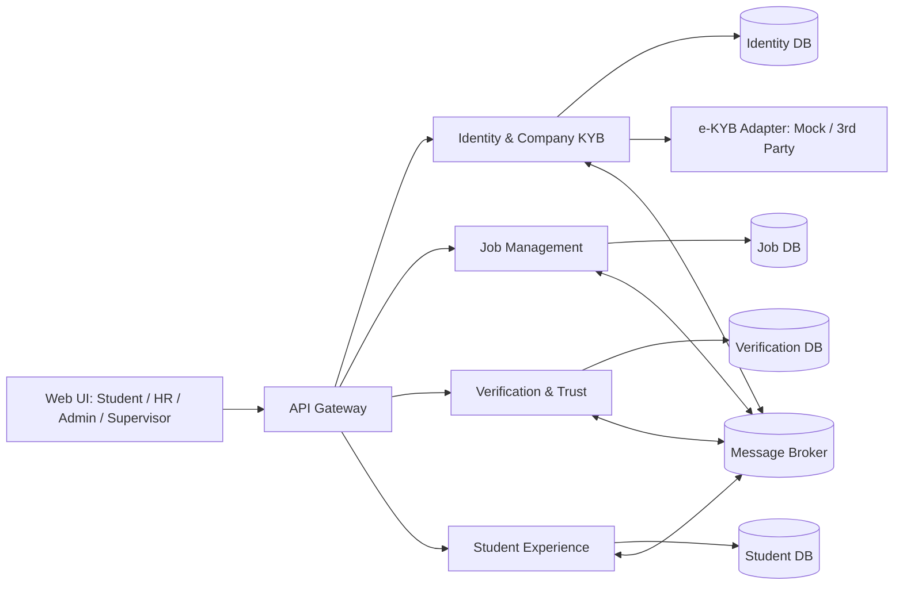
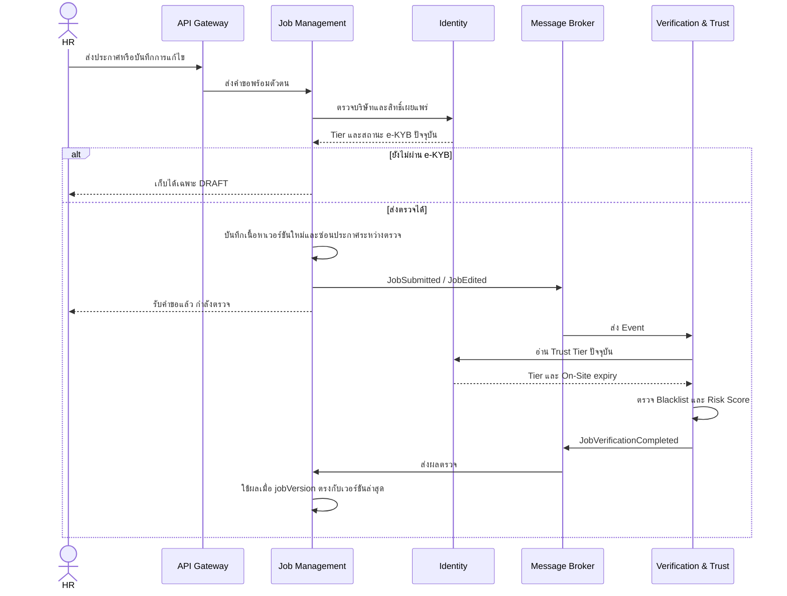

# System Architecture — University Internship Platform

**สถานะ:** แบบร่างสำหรับงาน SA, Week 1 
**เอกสารอ้างอิง:** `README.md`, `# 🛡️ Verification Rules & Risk Sco.txt`, `TODO.txt`

## 1. เป้าหมายและขอบเขต

ระบบเป็นแพลตฟอร์มตัวกลางสำหรับประกาศและสมัครฝึกงาน โดยตรวจตัวตนบริษัทก่อนให้เผยแพร่งาน ตรวจเนื้อหาและคะแนนความเสี่ยงของประกาศ และติดตามความน่าเชื่อถือหลังการสมัคร สถาปัตยกรรมประกอบด้วย API Gateway, 4 Microservices, Message Broker และตัวเชื่อมต่อ e-KYB แบบ 3rd Party/Mock รันร่วมกันด้วย Docker Compose สำหรับการสาธิต

เอกสารนี้กำหนด **ขอบเขตความรับผิดชอบและการไหลของข้อมูล** ก่อนลงรายละเอียด Database Schema, API Contract, Event Payload และเทคโนโลยีที่ใช้จริง

## 2. ภาพรวมส่วนประกอบ

| ส่วนประกอบ | เจ้าของข้อมูลและหน้าที่หลัก |
| --- | --- |
| API Gateway | จุดรับคำขอจาก Web UI, ตรวจ token เบื้องต้น, ส่งต่อไปยังบริการตาม route; ไม่เก็บข้อมูลธุรกิจ |
| Identity & Company KYB | บัญชีผู้ใช้, บทบาท, บริษัท, ผล e-KYB, Trust Tier และอายุ On-Site Badge; เป็นแหล่งอ้างอิงสถานะบริษัท |
| Job Management | ประกาศงาน, เจ้าของประกาศ, เวอร์ชันเนื้อหา, สถานะเผยแพร่และการค้นหางานที่เผยแพร่; HR จัดการประกาศของบริษัทตนเอง |
| Verification & Trust | Blacklist, กฎ Risk Score, ผลตรวจแต่ละเวอร์ชัน, คิว Admin, Report และการตรวจสถานที่โดย Supervisor |
| Student Experience | โปรไฟล์/เรซูเม่, ใบสมัคร, ผลการรับและการฝึกงาน, รีวิวที่ยืนยันสิทธิ์, Badge นักศึกษาและ E-Certificate |
| Message Broker | ส่งเหตุการณ์ระหว่างบริการแบบ asynchronous โดยเฉพาะการตรวจประกาศ เพื่อไม่ให้คำขอหน้าเว็บต้องรอประมวลผลครบทุกขั้น |
| e-KYB Adapter | อินเทอร์เฟซเดียวสำหรับ Mock และ 3rd Party; ผลจากภายนอกส่งกลับ Identity เพื่อให้ Admin พิจารณา |

แต่ละบริการเป็นเจ้าของฐานข้อมูลของตนเอง บริการอื่นเข้าถึงผ่าน API หรือ Event เท่านั้น ไม่มีการเขียนฐานข้อมูลข้ามบริการ

## 3. การไหลหลักของระบบ

### 3.1 สมัครบริษัทและ e-KYB

1. HR สมัครบัญชีผ่าน Gateway ไปยัง Identity; บริษัทเริ่มที่ Tier 0 และสร้างประกาศได้เฉพาะ `DRAFT`
2. HR ส่งเลขนิติบุคคล 13 หลักและเอกสารไปยัง Identity; Identity เรียก e-KYB Adapter
3. Identity บันทึกผลตรวจพร้อมที่มาและเวลา Admin ตรวจเอกสารและอนุมัติ จึงเลื่อนบริษัทเป็น Tier 1
4. การเลื่อนเป็น Tier 2 ใช้เงื่อนไขอนุมัติงานครบ 3 ครั้ง, นักศึกษาประเมิน Pass อย่างน้อย 1 คน และไม่เคยถูก Report; Identity รับข้อมูลผลจากบริการที่เป็นเจ้าของผ่าน Event
5. On-Site Badge จาก Supervisor มีอายุ 1 ปีปฏิทิน Identity เก็บวันหมดอายุและลดกลับ Tier 2 เมื่อหมดอายุจนกว่าจะตรวจซ้ำ

การไม่ตอบกลับของบริการ e-KYB ภายนอกต้องคงบริษัทไว้ในสถานะรอตรวจ ห้ามถือว่าผ่านโดยปริยาย

### 3.2 ส่ง ตรวจ และเผยแพร่ประกาศ

- พบ Blacklist ใน `job_title` หรือ `description` → `AUTO_REJECTED` โดยไม่ขึ้นกับคะแนน
- ไม่พบ Blacklist และคะแนน `< 20` → `PUBLISHED`; `20–69` → `PENDING_REVIEW`; `≥ 70` → `AUTO_REJECTED`
- Tier 1 และ Tier 2 ใช้เกณฑ์คะแนนเดียวกัน โดย Tier 2 ได้คะแนนลดตามกฎ; Tier เพียงอย่างเดียวไม่รับประกันผลอนุมัติ
- ทุกครั้งที่แก้ประกาศให้บันทึกเป็นเวอร์ชันใหม่ ซ่อนประกาศทั้งรายการระหว่างตรวจ แล้วตรวจอีกครั้ง ผลตรวจเวอร์ชันเก่าห้ามนำมาเผยแพร่ทับเวอร์ชันใหม่
- Admin อนุมัติหรือปฏิเสธงาน `PENDING_REVIEW` ผ่าน Verification แล้วส่งผลกลับไปให้ Job Management เปลี่ยนสถานะ

API Contract v1 กำหนดสถานะชั่วคราวระหว่างรอผลตรวจเป็น `VERIFYING` โดยไม่ตีความว่าเป็นการอนุมัติหรือการปฏิเสธ

### 3.3 สมัครงาน รายงาน รีวิว และ Certificate

1. Student Experience อ่านเฉพาะประกาศ `PUBLISHED` เพื่อให้นักศึกษาค้นหาและสมัครงาน และเป็นเจ้าของใบสมัครกับผลการฝึกงาน HR ดูหรือจัดการใบสมัครของบริษัทตนเองผ่านสิทธิ์ที่ตรวจโดยบริการเจ้าของข้อมูล
2. Verification รับ Report จากนักศึกษาและนับผู้รายงานที่ไม่ซ้ำกันต่อประกาศ เมื่อครบ 3 คน งาน Tier 1 ถูก `SUSPENDED` และซ่อนทันที ส่วน Tier 2/On-Site เข้าคิว Admin โดยยังไม่ระงับอัตโนมัติ
3. Student Experience เปิดให้รีวิวเมื่อสถานะฝึกงานเป็น `COMPLETED` ทั้งผู้ที่ Pass และ Fail และแสดงผล Pass/Fail กำกับรีวิว
4. Supervisor บันทึกการตรวจสถานที่ผ่าน Verification; ส่วนการอนุมัติ E-Certificate ทำผ่าน Student Experience และต้องตรวจช่วงวันเริ่มถึงวันสิ้นสุดฝึกงานไม่น้อยกว่า 30 วัน

## 4. สิทธิ์และความปลอดภัย

- Identity ออก token ที่ระบุ `userId` และบทบาท `STUDENT`, `COMPANY_HR`, `PLATFORM_ADMIN`, `SUPERVISOR`; Gateway และบริการปลายทางตรวจความถูกต้องและอายุ token
- บริการปลายทางตรวจสิทธิ์เชิงข้อมูลซ้ำ เช่น HR แก้ได้เฉพาะประกาศของบริษัทตนเอง และ Student รีวิวได้เฉพาะการฝึกงานของตนที่ `COMPLETED`
- ข้อมูล e-KYB และเรซูเม่เป็นข้อมูลที่ต้องจำกัดการเข้าถึง เก็บเฉพาะที่จำเป็นและไม่ใส่ข้อมูลอ่อนไหวลงใน Event หรือ log
- การติดต่อภายในระหว่างบริการต้องยืนยันตัวตนของบริการ ไม่เชื่อ role หรือ company ID ที่ส่งจาก Web UI โดยตรง

## 5. ความถูกต้องของข้อมูลและการรับมือความล้มเหลว

- Event ต้องมี `eventId`, `occurredAt`, รหัสสิ่งที่เกี่ยวข้อง และ `jobVersion` สำหรับผลตรวจประกาศ Consumer ประมวลผลซ้ำได้โดยไม่เปลี่ยนผล และ Job Management ไม่รับผลของเวอร์ชันเก่า
- การบันทึกข้อมูลธุรกิจกับการส่ง Event ต้องออกแบบให้ไม่สูญหายเมื่อ Broker ไม่พร้อม (เช่น transactional outbox); กำหนดรูปแบบจริงในขั้น API/Event Contract
- หาก Identity หรือ Verification ไม่พร้อม งานที่ยังตรวจไม่เสร็จต้องไม่ถูกเผยแพร่โดยปริยาย และต้องมีวิธี retry หรือให้ Admin ตรวจภายหลัง
- Search, badge และข้อมูลแสดงผลที่ได้จาก Event อาจตามหลังข้อมูลต้นทางชั่วคราว; สิทธิ์เผยแพร่และการออก Certificate ต้องตรวจข้อมูลปัจจุบันจากบริการเจ้าของข้อมูล

## 6. เอกสารต่อยอดและงานที่ต้องกำหนด

1. Database Schema ของแต่ละบริการและความสัมพันธ์ผ่าน ID ข้ามบริการอยู่ใน `docs/database-schema.md`
2. API Contract v1 ของ Auth, e-KYB, Jobs, Verification, Reports, Applications และ Supervisor อยู่ใน `docs/api-contract.md`
3. Event Payload, การส่งซ้ำ, versioning และการจัดการ Event ที่ส่งไม่สำเร็จอยู่ใน `docs/event-contract.md`
4. เทคโนโลยีที่ทีมจะใช้สำหรับ Gateway, Broker, Database และ e-KYB Mock ใน Docker Compose
5. สถานะชั่วคราว `VERIFYING` และรูปแบบตอบกลับ `202` ของ API อยู่ใน `docs/api-contract.md`

เอกสารนี้กำหนดภาพรวมสถาปัตยกรรม ส่วนรายละเอียด Database, HTTP API และ Event อยู่ในเอกสารที่เชื่อมไว้ข้างต้น
