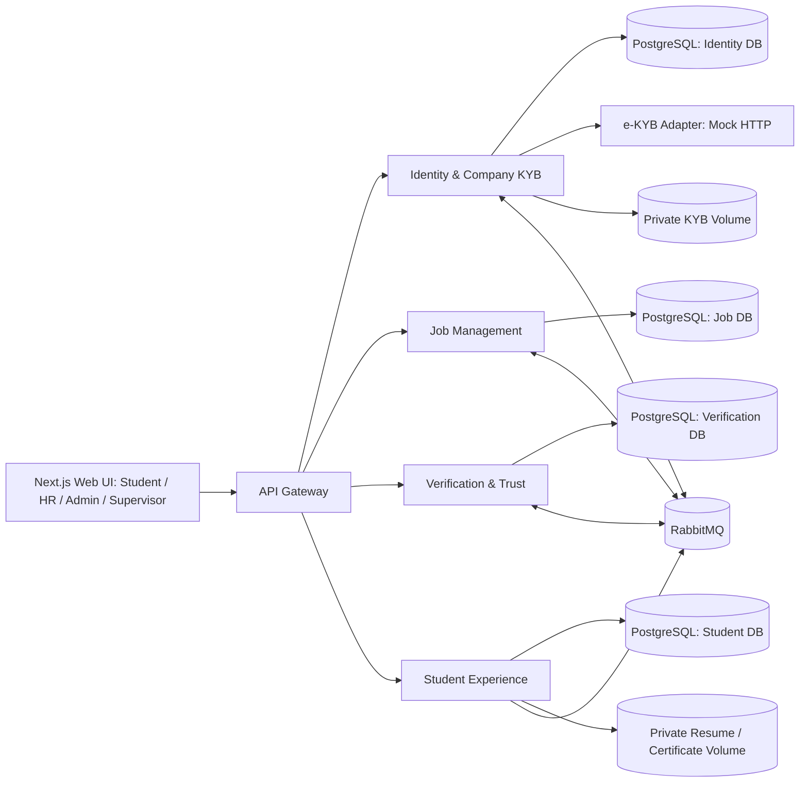
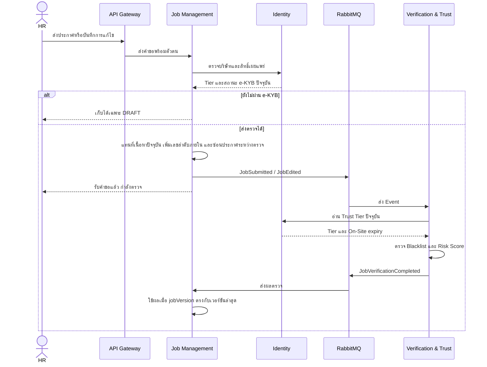

# System Architecture — University Internship Platform

**สถานะ:** เอกสารออกแบบสำหรับทีม ใช้อ้างอิงต่อเนื่องและปรับเมื่อขอบเขตหรือสถาปัตยกรรมเปลี่ยน 
**ลำดับอ่าน:** [สารบัญเอกสาร](README.md) → เอกสารนี้ → [Design Diagrams](diagrams.md) 
**เอกสารอ้างอิง:** [README หลัก](../README.md), [Verification Rules & Risk Score](<../Verification Rules & Risk Sco.txt>), [TODO](../TODO.txt)

## 1. เป้าหมายและขอบเขต

ระบบเป็นแพลตฟอร์มตัวกลางสำหรับประกาศและสมัครฝึกงาน โดยตรวจตัวตนบริษัทก่อนให้เผยแพร่งาน ตรวจเนื้อหาและคะแนนความเสี่ยงของประกาศ และติดตามความน่าเชื่อถือหลังการสมัคร สถาปัตยกรรมประกอบด้วย API Gateway, 4 Microservices, RabbitMQ และ e-KYB Mock ผ่าน Adapter รันร่วมกันด้วย Docker Compose สำหรับการสาธิต

เอกสารนี้กำหนด **ขอบเขตความรับผิดชอบ การไหลของข้อมูล และ stack ที่ทีมเลือก** ก่อนลงรายละเอียด Database Schema, API Contract และ Event Payload การใช้ PostgreSQL instance เดียวแยก database ต่อ Service เป็นแบบจัดวางสำหรับเดโมในเอกสาร SA นี้

### Stack ที่ทีมเลือก

| ส่วน | เทคโนโลยี |
| --- | --- |
| Web UI | Next.js + TypeScript + Tailwind CSS; หน้าและ React components ใช้ `.tsx` ส่วน logic ที่ไม่มี JSX ใช้ `.ts` |
| API Gateway และ 4 Microservices | NestJS + TypeScript (`.ts`); แยกแอปตามบริการ |
| ฐานข้อมูล | PostgreSQL; แต่ละบริการเป็นเจ้าของ database ของตนบน instance เดียวสำหรับเดโม |
| การเข้าฐานข้อมูล | Prisma ORM 7.x; แยก Prisma schema, client และ migration ตามบริการ โดย pin `prisma` และ `@prisma/client` เป็น major 7 เดียวกันใน lockfile |
| Event | RabbitMQ; รายละเอียด exchange/queue อยู่ใน `docs/event-contract.md` |
| e-KYB | Mock HTTP ใน Docker Compose หลัง Identity Adapter; ผล Mock เป็นข้อมูลให้ Admin ตัดสิน ไม่อนุมัติ Tier อัตโนมัติ |
| ไฟล์ | private Docker volume แยก Identity กับ Student Experience; DB เก็บ storage key/metadata และดาวน์โหลดผ่าน API ที่ตรวจสิทธิ์ |
| การทดสอบ | Mocha สำหรับ unit/API integration และ UAT ตามกรณีใน [README หลัก](../README.md) |
| การรันเดโม | Docker Compose ตามขอบเขตใน [README หลัก](../README.md) |

### ขอบเขตฟีเจอร์เชิงธุรกิจในเดโม 4 สัปดาห์

| รายการจาก README หลัก | ขอบเขตที่ออกแบบใน v1 |
| --- | --- |
| Featured / Boosted Job | มีสถานะ `is_featured` เพื่อแสดงป้ายและเรียงงานที่เผยแพร่แล้วไว้ก่อนงานทั่วไปในหน้าค้นหา; ข้อมูลเดโมกำหนดสถานะนี้จาก seed ที่ทีมควบคุม ไม่ให้ HR ส่งค่ามาเอง ยังไม่มีการซื้อหรือระบบเปิดสิทธิ์แบบชำระเงิน |
| Express KYB & Fast-Track Review | เป็นแนวคิดรายได้ใน README แต่แผน 4 สัปดาห์และ UAT ยังไม่กำหนดราคา สิทธิ์ หรือเกณฑ์คิวพิเศษ; v1 ใช้คิว KYB และคิวตรวจงานปกติตาม Risk Score ไม่ให้การเร่งคิวข้ามการตรวจของ Admin |
| HR Pro Subscription | README ระบุเป็น Future Phase; ไม่มี subscription, payment หรือ Talent Pool Search ใน v1 |

หากทีมจะเพิ่มการซื้อ Featured หรือคิว Express ภายหลัง ต้องกำหนดสิทธิ์ผู้เปิดใช้ ระยะเวลา และเงื่อนไขชำระเงินก่อนเพิ่ม API/ตารางสำหรับการขาย โดยไม่เปลี่ยนกฎ KYB และ Risk Score ที่ PM กำหนด

## 2. ภาพรวมส่วนประกอบ

Use Case, Activity, Sequence, ER, Class, System Architecture และ DFD รวมทั้ง structure/state diagrams สำหรับส่งต่อให้ทีมอยู่ใน `docs/diagrams.md`; โครงสร้าง workspace และรายการ dependencies อยู่ใน `docs/project-setup.md`

| ส่วนประกอบ | เจ้าของข้อมูลและหน้าที่หลัก |
| --- | --- |
| API Gateway | NestJS app รับคำขอจาก Web UI, ตรวจ token เบื้องต้น, ส่งต่อไปยังบริการตาม route; ไม่เก็บข้อมูลธุรกิจ |
| Identity & Company KYB | บัญชีผู้ใช้, บทบาท, บริษัท, ผล e-KYB, Trust Tier และอายุ On-Site Badge; เป็นแหล่งอ้างอิงสถานะบริษัท |
| Job Management | ประกาศงาน, เจ้าของประกาศ, เนื้อหาปัจจุบัน, เลขลำดับการแก้ไขภายใน, สถานะเผยแพร่และการค้นหางานที่เผยแพร่; HR จัดการประกาศของบริษัทตนเอง |
| Verification & Trust | Blacklist, กฎ Risk Score, ผลตรวจแต่ละเวอร์ชัน, คิว Admin, Report และการตรวจสถานที่โดย Supervisor |
| Student Experience | โปรไฟล์/เรซูเม่, ใบสมัคร, ผลการรับและการฝึกงาน, รีวิวที่ยืนยันสิทธิ์, Badge นักศึกษาและ E-Certificate |
| RabbitMQ | ส่งเหตุการณ์ระหว่างบริการแบบ asynchronous โดยเฉพาะการตรวจประกาศ เพื่อไม่ให้คำขอหน้าเว็บต้องรอประมวลผลครบทุกขั้น |
| e-KYB Adapter | Identity เรียก Mock HTTP ผ่านอินเทอร์เฟซที่เปลี่ยน provider ได้ภายหลัง; ผล Mock ส่งกลับ Identity เพื่อให้ Admin พิจารณา |

แต่ละบริการใช้ Prisma Client และ migration ของตนเองกับ database ที่ตนเป็นเจ้าของ บริการอื่นเข้าถึงผ่าน API หรือ Event เท่านั้น ไม่มีการอ่าน/เขียนฐานข้อมูลข้ามบริการ

## 3. การไหลหลักของระบบ

### 3.1 สมัครบริษัทและ e-KYB

1. HR สมัครบัญชีผ่าน Gateway ไปยัง Identity; บริษัทเริ่มที่ Tier 0 และสร้างประกาศได้เฉพาะ `DRAFT`
2. HR ส่งเลขนิติบุคคล 13 หลักและเอกสารไปยัง Identity; Identity เรียก e-KYB Adapter
3. Identity บันทึกผลตรวจพร้อมที่มาและเวลา Admin ตรวจเอกสารและอนุมัติ จึงเลื่อนบริษัทเป็น Tier 1
4. การเลื่อนเป็น Tier 2 ใช้ประกาศงานใหม่ที่เผยแพร่สำเร็จ 3 `job_id` ไม่ซ้ำกัน (นับทั้ง Auto-Approve และ Admin Approve), นักศึกษาประเมิน Pass อย่างน้อย 1 คน และไม่เคยมี Report ที่ Admin ยืนยันว่ามีมูล; การแก้ไขหรือเผยแพร่งานเดิมซ้ำไม่นับเพิ่ม Identity รับข้อมูลผ่าน Event
5. On-Site Badge จาก Supervisor มีอายุ 1 ปีปฏิทิน Identity เก็บวันหมดอายุและลดกลับ Tier 2 เมื่อหมดอายุจนกว่าจะตรวจซ้ำ

การไม่ตอบกลับของบริการ e-KYB ภายนอกต้องคงบริษัทไว้ในสถานะรอตรวจ ห้ามถือว่าผ่านโดยปริยาย

### 3.2 ส่ง ตรวจ และเผยแพร่ประกาศ

- พบ Blacklist ใน `job_title` หรือ `description` → `AUTO_REJECTED` โดยไม่ขึ้นกับคะแนน
- ไม่พบ Blacklist และคะแนน `< 20` → `PUBLISHED`; `20–69` → `PENDING_REVIEW`; `≥ 70` → `AUTO_REJECTED`
- Tier 1 และ Tier 2 ใช้เกณฑ์คะแนนเดียวกัน โดย Tier 2 ได้คะแนนลดตามกฎ; Tier เพียงอย่างเดียวไม่รับประกันผลอนุมัติ
- ทุกครั้งที่แก้ประกาศที่เคยเผยแพร่ให้แทนที่เนื้อหาปัจจุบัน เปลี่ยนเป็น `VERIFYING` และซ่อนทั้งรายการทันที แล้วตรวจ Blacklist และ Risk Score ใหม่ ไม่แสดงเนื้อหาเก่าระหว่างรอผล เลข `jobVersion` ใช้กันผลตรวจที่มาช้าเท่านั้น ไม่ใช่ระบบเก็บหรือแสดงเนื้อหาเวอร์ชันเก่า
- Admin อนุมัติหรือปฏิเสธงาน `PENDING_REVIEW` ผ่าน Verification แล้วส่งผลกลับไปให้ Job Management เปลี่ยนสถานะ

API Contract v1 กำหนดสถานะชั่วคราวระหว่างรอผลตรวจเป็น `VERIFYING` โดยไม่ตีความว่าเป็นการอนุมัติหรือการปฏิเสธ

### 3.3 สมัครงาน รายงาน รีวิว และ Certificate

1. Student Experience อ่านเฉพาะประกาศ `PUBLISHED` เพื่อให้นักศึกษาค้นหาและสมัครงาน และเป็นเจ้าของใบสมัครกับผลการฝึกงาน HR ดูหรือจัดการใบสมัครของบริษัทตนเองผ่านสิทธิ์ที่ตรวจโดยบริการเจ้าของข้อมูล
2. Verification รับ Report จากนักศึกษาและนับผู้รายงานที่ไม่ซ้ำกันต่อประกาศ เมื่อครบ 3 คน งาน Tier 1 ถูก `SUSPENDED` และซ่อนทันทีพร้อมเปิดเคสให้ Admin ตรวจ ส่วน Tier 2/On-Site เข้าคิวสีเหลืองตั้งแต่ Report แรกโดยยังไม่ระงับอัตโนมัติ หาก Admin ยืนยันว่ามีมูล Identity บันทึกหลักฐานและลด Tier 2 เป็น Tier 1; Report ที่ยังไม่ยืนยันหรือถูกยกคำร้องไม่ทำให้ลด Tier
3. Student Experience เปิดให้รีวิวเมื่อสถานะฝึกงานเป็น `COMPLETED` ทั้งผู้ที่ Pass และ Fail และแสดงผล Pass/Fail กำกับรีวิว
4. Supervisor บันทึกการตรวจสถานที่ผ่าน Verification; ส่วนการอนุมัติ E-Certificate ทำผ่าน Student Experience และต้องตรวจช่วงวันเริ่มถึงวันสิ้นสุดฝึกงานไม่น้อยกว่า 30 วัน

## 4. สิทธิ์และความปลอดภัย

- Identity ออก JWT แบบ ES256 อายุ 60 นาที มี `sub` (user ID), `role`, `iss`, `aud`, `iat`, `exp`; Identity เก็บ private key ส่วน Gateway/บริการปลายทางตรวจด้วย public key รวมทั้ง issuer, audience, อายุและบทบาท ไม่มี refresh token ในเดโม เมื่อหมดอายุให้ล็อกอินใหม่
- รหัสผ่านเก็บเป็น Argon2id hash; บัญชี Admin/Supervisor สร้างผ่านคำสั่ง bootstrap ของ Identity ที่ผู้ดูแลรันเฉพาะตอนเตรียมเดโม ไม่มี public signup หรือรหัสผ่านตั้งต้นใน Git
- บริการปลายทางตรวจสิทธิ์เชิงข้อมูลซ้ำ เช่น HR แก้ได้เฉพาะประกาศของบริษัทตนเอง และ Student รีวิวได้เฉพาะการฝึกงานของตนที่ `COMPLETED`
- ข้อมูล e-KYB และเรซูเม่เป็นข้อมูลที่ต้องจำกัดการเข้าถึง เก็บเฉพาะที่จำเป็นและไม่ใส่ข้อมูลอ่อนไหวลงใน Event หรือ log
- การติดต่อภายในระหว่างบริการต้องยืนยันตัวตนของบริการ ไม่เชื่อ role หรือ company ID ที่ส่งจาก Web UI โดยตรง

## 5. ความถูกต้องของข้อมูลและการรับมือความล้มเหลว

- Event ต้องมี `event_id`, `occurred_at`, รหัสสิ่งที่เกี่ยวข้อง และ `job_version` สำหรับผลตรวจประกาศ Consumer ประมวลผลซ้ำได้โดยไม่เปลี่ยนผล และ Job Management ไม่รับผลของเวอร์ชันเก่า
- การบันทึกข้อมูลธุรกิจกับ Outbox อยู่ใน PostgreSQL transaction เดียวกันผ่าน Prisma; publisher ส่งจาก Outbox เข้า RabbitMQ ภายหลัง commit เพื่อไม่ให้ Event สูญหายเมื่อ Broker ไม่พร้อม
- หาก Identity หรือ Verification ไม่พร้อม งานที่ยังตรวจไม่เสร็จต้องไม่ถูกเผยแพร่โดยปริยาย และต้องมีวิธี retry หรือให้ Admin ตรวจภายหลัง
- Search, badge และข้อมูลแสดงผลที่ได้จาก Event อาจตามหลังข้อมูลต้นทางชั่วคราว; สิทธิ์เผยแพร่และการออก Certificate ต้องตรวจข้อมูลปัจจุบันจากบริการเจ้าของข้อมูล

## 6. เอกสารต่อยอดตามลำดับอ่าน

1. [Design Diagrams](diagrams.md): ภาพ 7 ประเภทที่ PM ขอและภาพประกอบเพิ่มเติม
2. [API Contract v1](api-contract.md): Auth, e-KYB, Jobs, Verification, Reports, Applications และ Supervisor
3. [Event Contract v1](event-contract.md): Event payload, routing, การส่งซ้ำ และ DLQ
4. [Database Schema](database-schema.md): ตารางของแต่ละบริการและความสัมพันธ์ผ่าน ID ข้ามบริการ
5. [Project Setup Handoff](project-setup.md): โครงสร้าง workspace, dependencies และแนวทางตั้งค่าเดโม

เอกสารนี้กำหนดภาพรวมสถาปัตยกรรม ส่วนรายละเอียด HTTP API, Event และ Database อยู่ในเอกสารที่เชื่อมไว้ข้างต้น
