# Design Diagrams — University Internship Platform

**สถานะ:** แผนภาพอ้างอิงสำหรับเดโม 4 สัปดาห์ ปรับตาม contract ที่ทีมตกลง 
**ลำดับอ่าน:** [สารบัญเอกสาร](README.md) → [System Architecture](architecture.md) → เอกสารนี้ 
**อ้างอิง:** [README หลัก](../README.md), [TODO](../TODO.txt), [API Contract](api-contract.md), [Event Contract](event-contract.md), [Database Schema](database-schema.md)

แผนภาพนี้ใช้ชื่อ service, database, endpoint และ event ตาม contract ปัจจุบัน ถ้าเปลี่ยน contract ให้แก้แผนภาพที่เกี่ยวข้องด้วย ภาพเป็นภาพรวม; ฟิลด์ เงื่อนไข และสิทธิ์ที่ละเอียดให้ยึดเอกสาร contract

**ภาพหลักเรียงตามที่ PM ขอในข้อ 1–7** แล้วตามด้วยภาพ State และรายการส่งต่องานในข้อ 8–9 Use Case และ Activity ใช้ Mermaid `flowchart` พร้อมสัญลักษณ์ actor, use case, action และ decision เพื่อให้ Markdown preview แสดงผลได้

## 1. Use Case Diagram — ผู้ใช้งานกับความสามารถหลัก

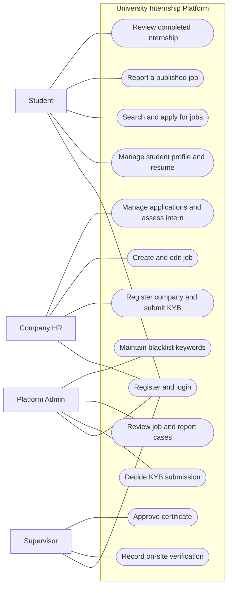

Student ที่ฝึกจบแล้วรีวิวได้ทั้งผล PASS และ FAIL; Certificate อนุมัติได้เฉพาะ PASS และระยะฝึกอย่างน้อย 30 วัน HR เผยแพร่ประกาศได้หลังผ่าน KYB และผล Risk Score ตามกฎ

## 2. Activity Diagram — การส่งตรวจและเผยแพร่ประกาศ

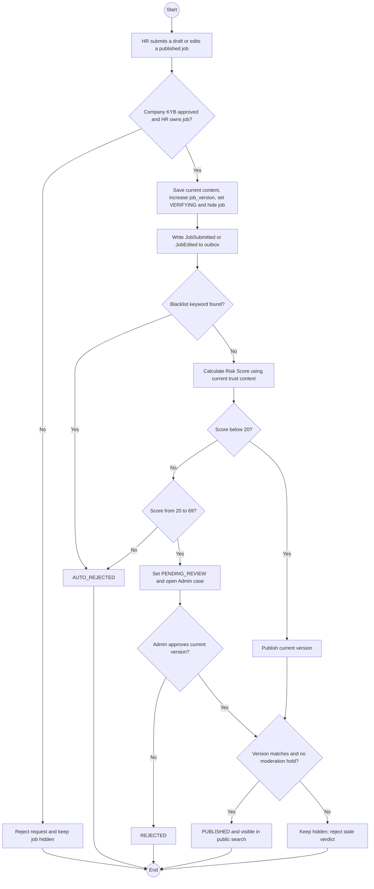

การแก้ประกาศที่เผยแพร่แล้วต้องซ่อนก่อนตรวจใหม่ทันที; ผลตรวจที่อ้าง `job_version` เก่าไม่ทำให้เผยแพร่กลับ และ blacklist มาก่อนการพิจารณาช่วงคะแนน

## 3. Sequence Diagram — การไหลข้ามบริการ

### 3.1 สมัครบริษัทและ e-KYB

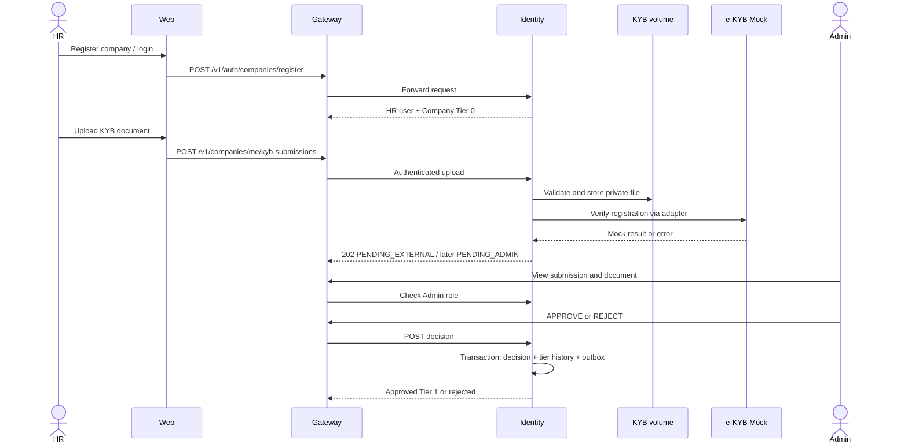

ผล Mock เป็นหลักฐานประกอบเท่านั้น Admin อนุมัติจึงเป็น Tier 1; หาก Mock error ให้คง Tier 0 ตามสถานะ `EXTERNAL_ERROR`

### 3.2 เข้าสู่ระบบและตรวจสิทธิ์

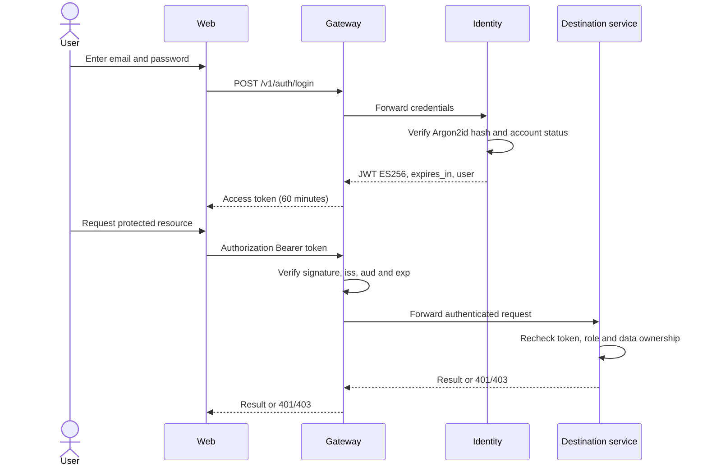

Identity ถือ private key; Gateway/บริการอื่นถือ public key ผู้ดูแลสร้างบัญชี Admin/Supervisor ผ่าน bootstrap command ก่อนเดโม

### 3.3 ส่งตรวจ แก้ และเผยแพร่ประกาศ

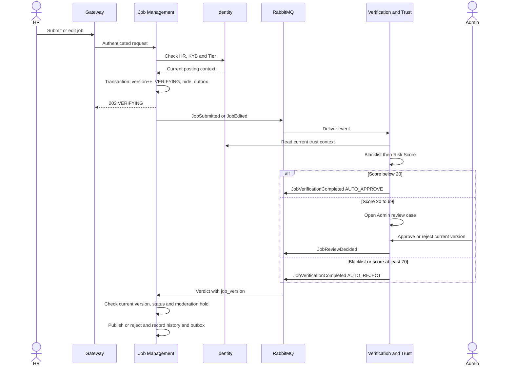

เมื่อแก้งาน `PUBLISHED` ให้ซ่อนทันที ไม่มีหน้าแสดงเวอร์ชันเก่า และไม่รับ verdict ของ `job_version` เก่า

### 3.4 Report และการปรับ Tier

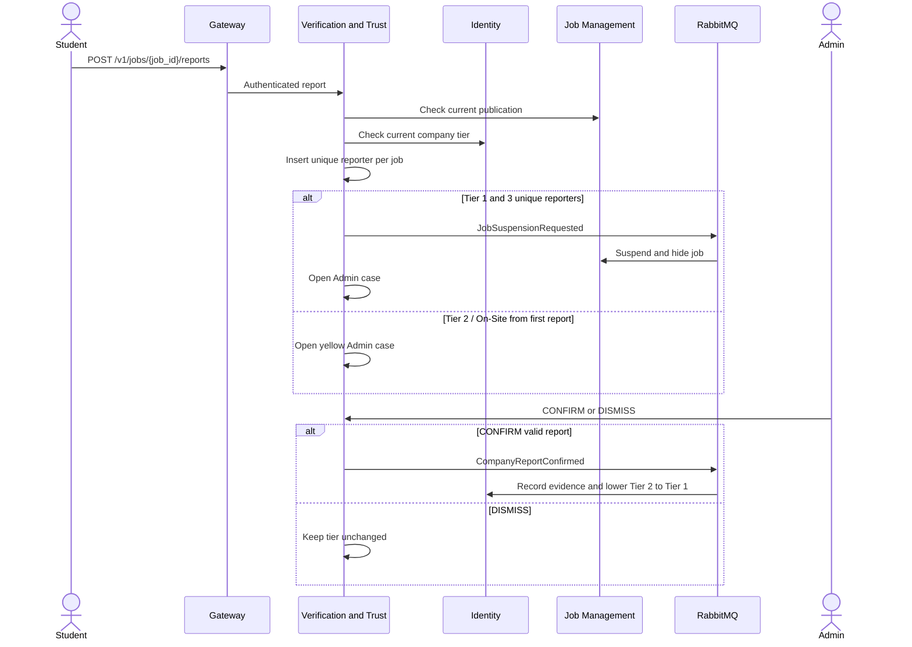

Tier 2/On-Site ไม่ Auto-Suspend จาก Report แรก; Admin สั่งระงับงานได้แยกจากการลด Tier รายละเอียดอยู่ใน Event/API Contract

### 3.5 รับฝึก รีวิว และ Certificate

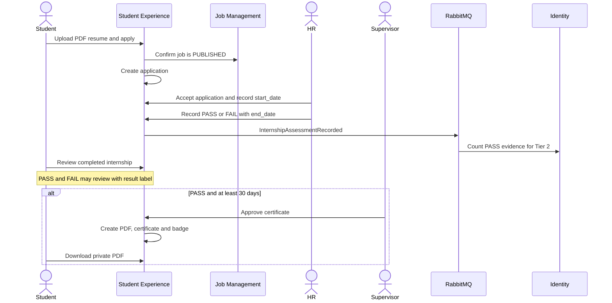

## 4. ER Diagram — แยกตามเจ้าของฐานข้อมูล

เส้นความสัมพันธ์ด้านล่างเป็นความสัมพันธ์ **ภายใน database เดียวกัน** เท่านั้น คอลัมน์ `company_id`, `job_id`, `student_id` ที่อ้างข้อมูลบริการอื่นเป็น logical reference ผ่าน API/Event ไม่สร้าง foreign key ข้าม database แผนภาพแสดงฟิลด์สำคัญ ส่วนตารางและ constraints ครบอยู่ใน `docs/database-schema.md`

### 4.1 Identity and Company KYB DB

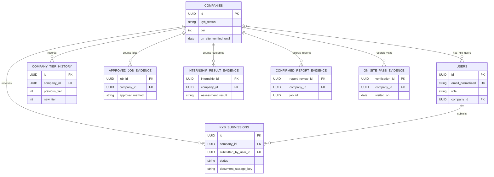

`USERS.company_id` เป็น nullable สำหรับ Student/Admin/Supervisor; evidence IDs ที่มาจาก service อื่นไม่มี FK ไปยังต้นทาง

### 4.2 Job Management DB

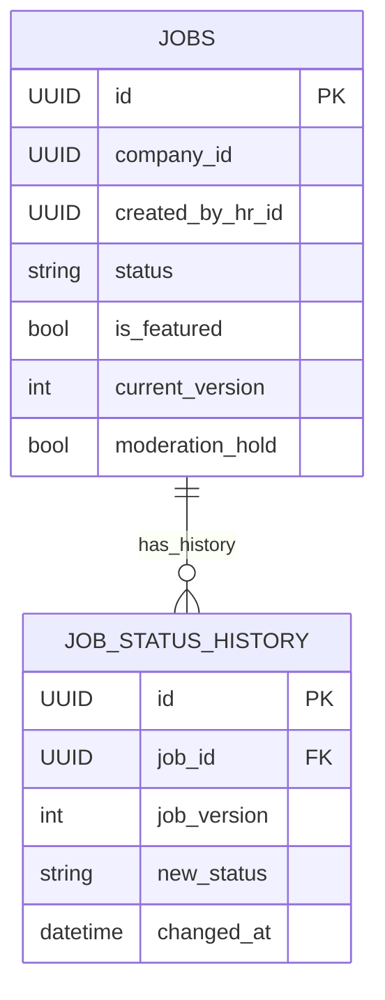

`JOBS` เก็บเนื้อหาปัจจุบันเท่านั้น; `is_featured` ใช้แสดงป้ายและเรียงงานที่ `PUBLISHED` ในเดโม โดยไม่ข้ามการตรวจงาน; `current_version` ใช้กันผลตรวจเก่า ไม่ใช่ระบบแสดงประกาศเวอร์ชันเก่า

### 4.3 Verification and Trust DB

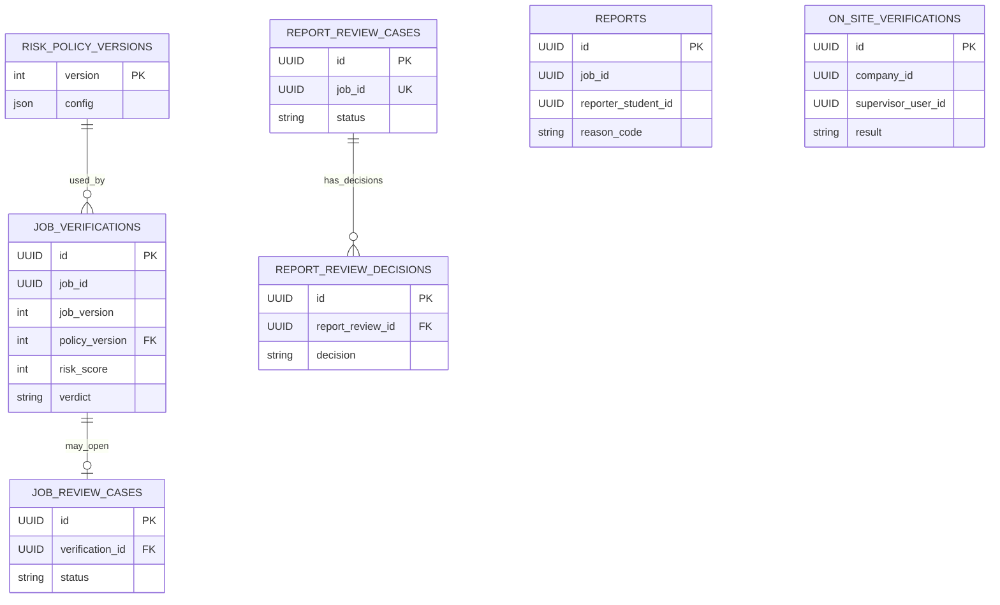

`REPORTS` กับ `REPORT_REVIEW_CASES` เชื่อมกันด้วย `job_id` เชิงธุรกิจและการนับผู้รายงานไม่ซ้ำ ไม่ได้มี FK ตรงระหว่างสองตาราง

### 4.4 Student Experience DB

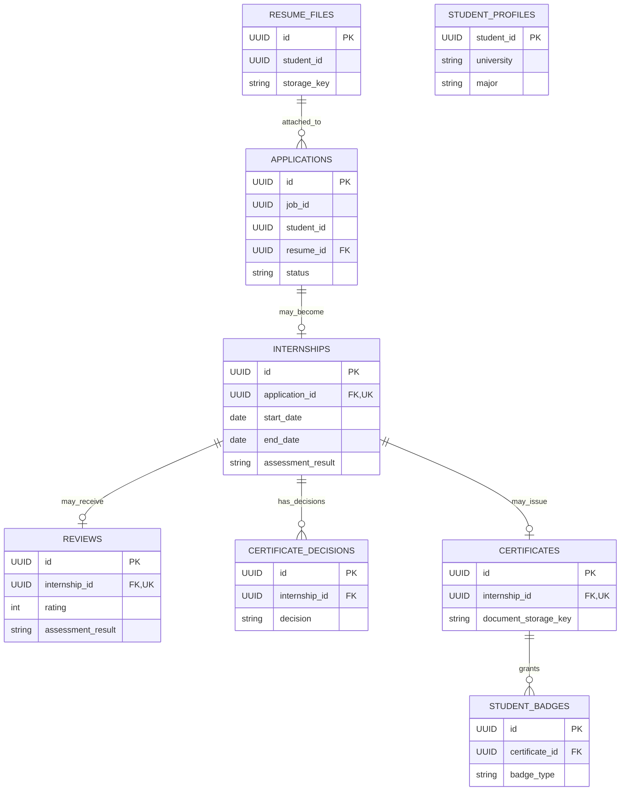

`STUDENT_PROFILES.student_id`, `RESUME_FILES.student_id` และ `APPLICATIONS.student_id` อ้าง User ID จาก Identity เชิงตรรกะ ไม่มี FK ข้าม service

## 5. Class Diagram — โครงออกแบบภายในบริการ

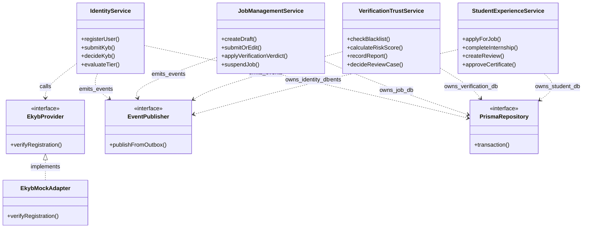

นี่เป็น **class design เชิงตรรกะ** ก่อนสร้างไฟล์จริง ไม่ได้กำหนดว่าทุก service ต้อง import `PrismaRepository` class เดียวกัน; แต่ละบริการมี repository/Prisma Client ของตัวเอง การสื่อสารข้ามบริการใช้ HTTP API และ Event ตาม contract

## 6. System Architecture Diagram — โครงสร้างและการจัดวาง

### 6.1 Structure Diagram — ที่อยู่ของงานแต่ละทีม

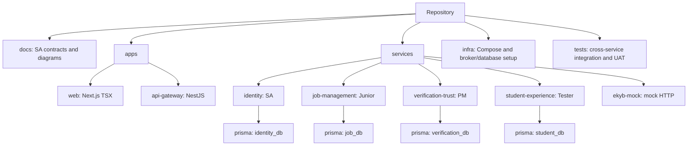

| Path | ขอบเขต |
| --- | --- |
| `apps/web/` | หน้าของ Student, HR, Admin และ Supervisor; เรียก Gateway เท่านั้น |
| `apps/api-gateway/` | ตรวจ JWT เบื้องต้นและส่ง route ไป service เจ้าของข้อมูล; ไม่ใช้ Prisma |
| `services/identity/` | Auth, Company, KYB, Tier และ On-Site Badge; เจ้าของ `identity_db` และ KYB volume |
| `services/job-management/` | Job, public search, publication status; เจ้าของ `job_db` |
| `services/verification-trust/` | Blacklist, Risk Score, คิวตรวจ, Report และ On-Site visit; เจ้าของ `verification_db` |
| `services/student-experience/` | Profile, Resume, Application, Internship, Review, Certificate; เจ้าของ `student_db` และไฟล์นักศึกษา |
| `services/ekyb-mock/` | HTTP mock หลัง Identity adapter ไม่มีฐานข้อมูลธุรกิจ |
| `infra/` | Docker Compose, การตั้งค่า PostgreSQL/RabbitMQ และ volume |
| `tests/` | Integration ข้ามบริการ, mock fixtures และ UAT 9 เคส |

ทุก Nest service ที่เป็นเจ้าของ DB วาง `prisma/` (schema และ migrations), `src/` (ไฟล์บริการ) และ `test/` (unit/API test) ใน service ของตน; Gateway กับ Mock มี `src/` และ `test/`; Web มี `src/app/`, `src/components/`, `src/lib/` และ `test/` โฟลเดอร์ที่เตรียมไว้ยังไม่มีไฟล์ฟีเจอร์ ผู้รับผิดชอบสร้างภายหลัง

### 6.2 Deployment Diagram — เดโมบนเครื่องเดียว

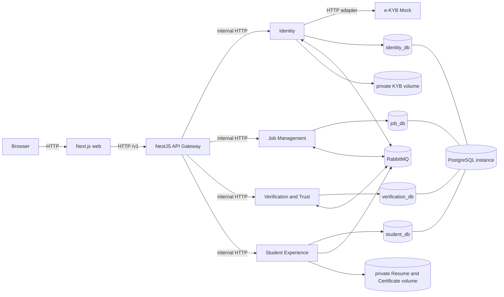

Compose เปิดพอร์ตให้ Browser เข้า Web/Gateway ตามที่กำหนดตอน implement; PostgreSQL, RabbitMQ, Mock, private volumes และ internal service APIs อยู่ในเครือข่ายภายในเดโม ไม่เปิดไฟล์เป็น public static path PostgreSQL เป็น instance เดียวแต่แยก database และบัญชีต่อ service

### 6.3 Event Topology — RabbitMQ

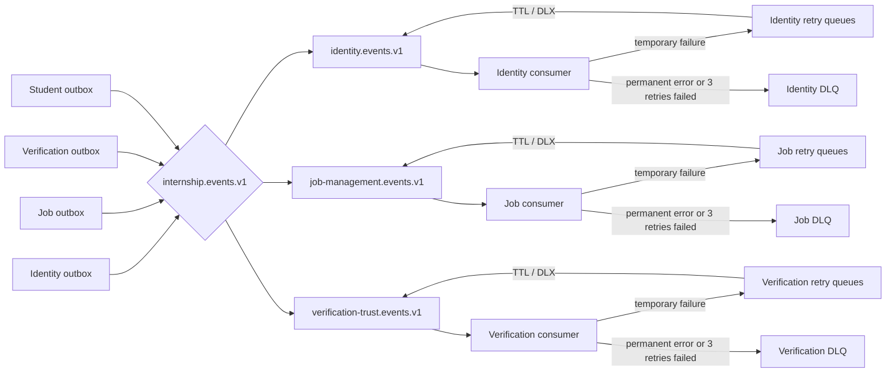

Publisher confirm ก่อน mark Outbox ว่าส่งแล้ว; Consumer เขียน business data และ `processed_events` ใน transaction เดียวกันก่อน ACK รายชื่อ binding key อยู่ใน `docs/event-contract.md`

### 6.4 Data Ownership Diagram — ความสัมพันธ์หลัก

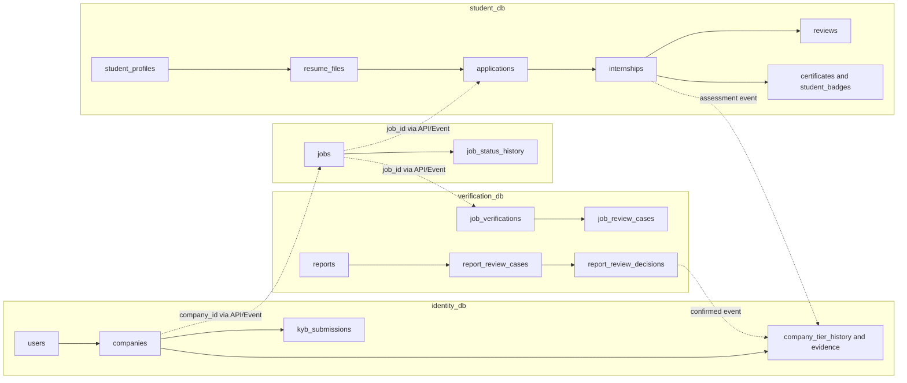

เส้นประคือ ID อ้างอิงข้าม service ผ่าน API/Event **ไม่ใช่ foreign key ข้าม database** ทุก service ที่ใช้ Event มี outbox/inbox ของตนตาม `docs/database-schema.md`

## 7. Data Flow Diagram (DFD) — Context และ Level 1

### 7.1 Context DFD

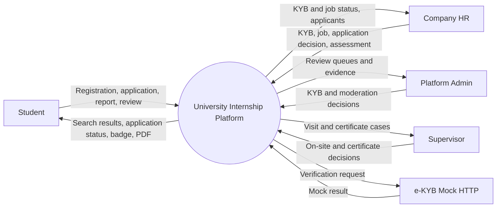

### 7.2 Level 1 DFD

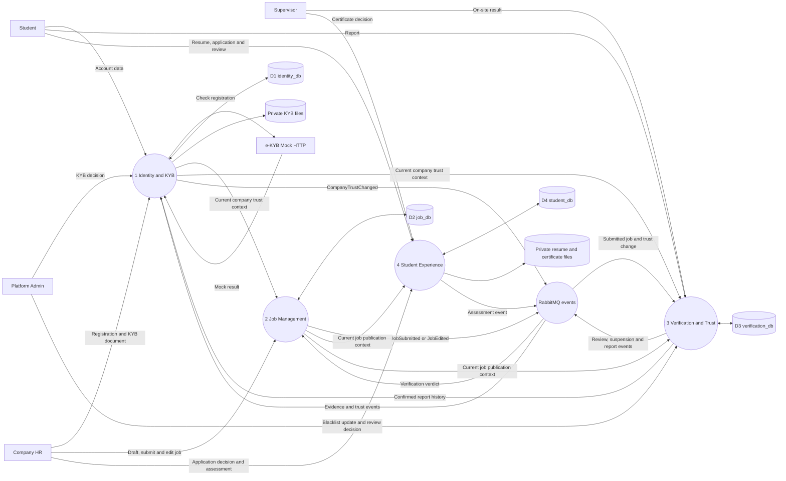

DFD แสดง **ข้อมูลที่ไหลและที่เก็บข้อมูล**; ทุก HTTP request จากผู้ใช้ผ่าน API Gateway แม้ไม่ได้วาด Gateway ซ้ำใน Level 1 เพราะ Gateway ไม่เป็นเจ้าของข้อมูลธุรกิจ เส้น Event ผ่าน RabbitMQ ตาม routing ใน `docs/event-contract.md`

## 8. State Diagrams — สถานะธุรกิจเพิ่มเติม

### 8.1 สถานะประกาศงาน

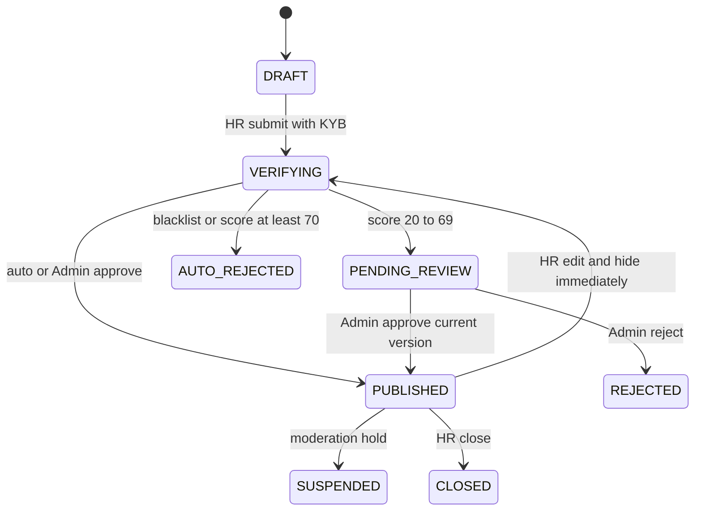

การปลด `SUSPENDED` ยังไม่มี endpoint/workflow ใน API Contract v1; หากทีมเพิ่มภายหลังต้องเป็นการตัดสินของ Admin ที่ตรวจสถานะปัจจุบัน ห้าม HR submit หรือแก้เพื่อข้าม moderation hold; `CLOSED` ไม่เปิดใหม่จาก verdict ที่มาช้า

### 8.2 Trust Tier และ On-Site Badge

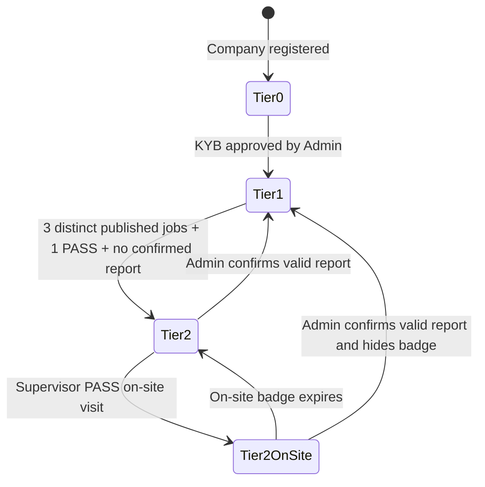

Report ที่ยังไม่ยืนยันหรือถูก DISMISS ไม่เปลี่ยน Tier; การเลื่อน Tier 2 ตรวจข้อมูลล่าสุดจาก Verification ก่อนเสมอ

## 9. ก่อนเริ่มเขียนไฟล์ฟีเจอร์

1. เจ้าของแต่ละ service ตรวจ path, database ownership และ contract ที่ต้อง implement
2. ทีมตกลงชื่อ environment variables, ports และ Compose config ใน `infra/` ก่อนเปิด service จริง
3. เมื่อเริ่มเขียนโค้ด ให้สร้าง Prisma schema/migrations ใน service เจ้าของข้อมูล แล้วทดสอบ API และ Event ตาม diagram และ contract
4. ทดสอบ UAT ทั้ง 9 เคสใน [README หลัก](../README.md); ถ้า diagram กับ business rule ขัดกัน ให้แก้ diagram/contract ร่วมกันก่อน implement
